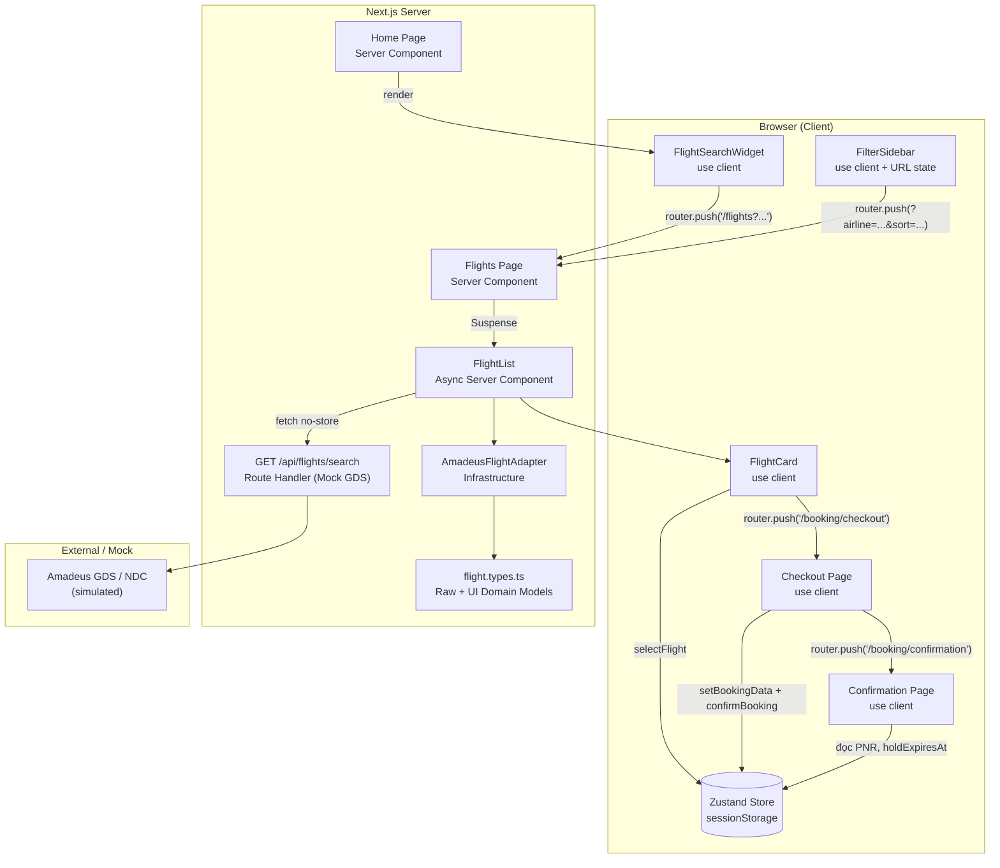
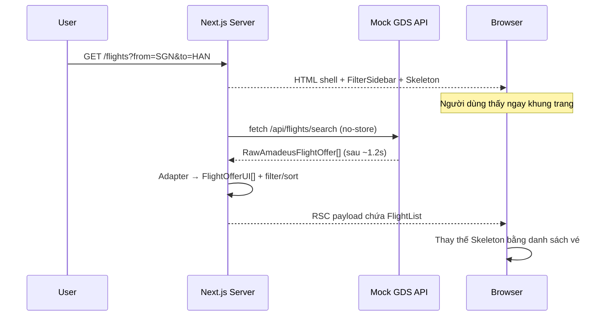
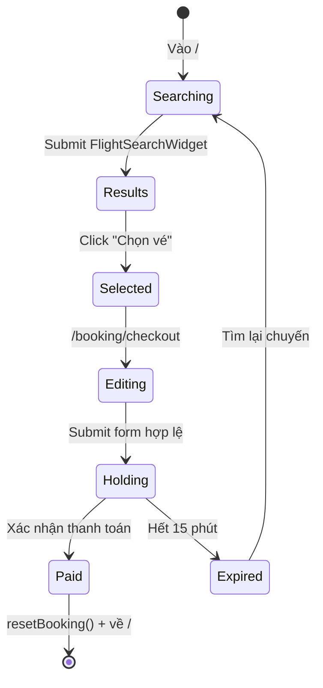

# EnVietBooker — OTA Flight Booking

Nền tảng đặt vé máy bay theo phong cách OTA (Online Travel Agency), xây dựng trên **Next.js 16 App Router**, **React 19
Server Components**, **TypeScript** và **Tailwind CSS v4**.

Dự án mô phỏng trọn vẹn hành trình người dùng:

```text
Tìm chuyến bay → Xem kết quả → Chọn vé → Nhập thông tin hành khách
→ Chọn dịch vụ bổ trợ → Giữ chỗ (PNR + đếm ngược 15 phút) → Thanh toán
```

> Đây là dự án học thuật/demo. Dữ liệu chuyến bay, PNR và thanh toán đều được mô phỏng, **không kết nối GDS/NDC thật**.

---

## Mục lục

1. [Tổng quan kiến trúc](#1-tổng-quan-kiến-trúc-architectural-blueprint)
2. [CSR vs. SSR & kỹ thuật Streaming](#2-csr-vs-ssr--kỹ-thuật-streaming)
3. [Design Patterns](#3-design-patterns)
4. [Quản lý trạng thái & vòng đời phiên đặt chỗ](#4-quản-lý-trạng-thái--vòng-đời-phiên-đặt-chỗ-zustand--persist)
5. [Cấu trúc thư mục](#5-cấu-trúc-thư-mục-feature-driven-modular)
6. [Hướng dẫn cài đặt & chạy dự án](#6-hướng-dẫn-cài-đặt--chạy-dự-án)

---

## 1. Tổng quan kiến trúc (Architectural Blueprint)

### 1.1. Triết lý thiết kế

Dự án được tổ chức theo **Feature-Driven Modular Architecture** kết hợp **Clean Architecture thu nhỏ**:

- **App Router (`src/app`)** chỉ chịu trách nhiệm routing, SEO metadata, composition và streaming.
- **Feature (`src/features`)** chứa toàn bộ nghiệp vụ theo domain: `flights`, `booking`.
- **Domain layer** là TypeScript thuần, không phụ thuộc React/Next.js → dễ test, dễ tái sử dụng.
- **Infrastructure layer** là nơi duy nhất biết về API bên thứ ba (Amadeus/GDS/NDC).
- **Shared (`src/shared`)** chứa thành phần dùng chung: layout, brand, hook, tiện ích.
- **UI primitives (`src/components/ui`)** là các component shadcn/Base UI.

### 1.2. Sơ đồ tổng thể



### 1.3. Tech stack

| Thành phần    | Công nghệ                                            | Vai trò                                 |
|---------------|------------------------------------------------------|-----------------------------------------|
| Framework     | **Next.js 16.4.1** (App Router, Turbopack)           | Routing, RSC, streaming, Route Handlers |
| UI runtime    | **React 19.3**                                       | Server/Client Components, `Suspense`    |
| Ngôn ngữ      | **TypeScript 5** (`strict`, `noUnusedLocals`)        | Type safety cho domain GDS/NDC          |
| Styling       | **Tailwind CSS v4** + `tw-animate-css`               | Design tokens, responsive               |
| UI primitives | **shadcn** + **Base UI** (`@base-ui/react`)          | Popover, Select, Dialog, Calendar…      |
| Form          | **React Hook Form 7** + **Zod 4**                    | Validation & quản lý form               |
| State         | **Zustand 5** + `persist` middleware                 | Giỏ đặt chỗ xuyên trang                 |
| Utility       | `date-fns`, `lucide-react`, `clsx`, `tailwind-merge` | Ngày giờ, icon, class merging           |

### 1.4. Cấu hình Next.js quan trọng

`next.config.ts`:

```ts
const nextConfig: NextConfig = {
  cacheComponents: true,
  partialPrefetching: true,
  turbopack: {
    rules: {
      '*.css': {
        loaders: ['@tailwindcss/turbopack'],
        as: '*.css',
      },
    },
  },
};
```

- **`cacheComponents: true`**: bật mô hình Cache Components của Next.js 16. Mọi truy cập dữ liệu động (`Date.now()`,
  `Math.random()`, `fetch`, `searchParams`…) phải nằm trong vùng được phép — thường là trong `<Suspense>` hoặc sau
  `await`.
- **`partialPrefetching: true`**: cho phép prefetch một phần route, ưu tiên render phần tĩnh trước.
- **Turbopack** xử lý CSS qua loader riêng của Tailwind v4.

> Đây là lý do nhiều đoạn code trong dự án có guard `typeof window !== 'undefined'` hoặc khai báo hằng số thay vì gọi
> `new Date()` khi render. Xem mục [2.4](#24-những-cạm-bẫy-ssr--hydration-trong-dự-án).

### 1.5. Bản đồ route

| Route                   | Loại                   | Rendering           | Mô tả                                      |
|-------------------------|------------------------|---------------------|--------------------------------------------|
| `/`                     | Server Component       | Static/Prerender    | Hero, tìm kiếm, điểm đến, khuyến mãi       |
| `/flights`              | Async Server Component | Dynamic + Streaming | Kết quả tìm kiếm, filter, sort             |
| `/booking/checkout`     | Client Component       | Client              | Form hành khách + dịch vụ + chiết tính giá |
| `/booking/confirmation` | Client Component       | Client              | PNR, countdown 15 phút, thanh toán         |
| `/api/flights/search`   | Route Handler          | Dynamic             | Mock API chuẩn Amadeus (GDS/NDC)           |

---

## 2. CSR vs. SSR & kỹ thuật Streaming

### 2.1. Server Components (SSR/RSC) làm mặc định

Trong App Router, **mọi component là Server Component cho đến khi có `'use client'`**. Server Components:

- Render trên server; lần tải đầu trả **HTML đã render**, các lần điều hướng sau trao đổi bằng **RSC Payload**.
  Component không kéo theo JS bundle tương tác.
- Có thể `async/await` trực tiếp, truy cập `process.env`, đọc `searchParams`.
- **Không** dùng được `useState`, `useEffect`, event handler, browser API.
- Không bị đẩy vào JS bundle → giảm kích thước tải xuống.

Các Server Component tiêu biểu trong dự án:

| File                                                     | Nhiệm vụ                                              |
|----------------------------------------------------------|-------------------------------------------------------|
| `src/app/page.tsx`                                       | Compose các section trang chủ                         |
| `src/app/flights/page.tsx`                               | Đọc `searchParams`, tạo metadata động, bọc `Suspense` |
| `src/features/flights/components/FlightList.tsx`         | `async` component gọi API + adapter                   |
| `src/features/flights/components/FlightListSkeleton.tsx` | Fallback thuần trình bày                              |
| `src/features/flights/components/home/*`                 | Các section marketing tĩnh                            |

#### Ví dụ 1 — Page đọc `searchParams` (Next.js 16)

```tsx
// src/app/flights/page.tsx
export const instant = false;

interface PageProps {
  searchParams: Promise<{
    from?: string;
    to?: string;
    deptDate?: string;
    airline?: string;
    sort?: string;
  }>;
}

export default async function FlightsPage({searchParams}: PageProps) {
  const resolvedParams = await searchParams;
  // ...
}
```

Điểm cần nhớ:

- Ở Next.js 15/16, `searchParams` và `params` là **Promise** → phải `await`.
- `export const instant = false` **tắt kiểm tra instant-navigation** cho segment này. Nó không đổi mô hình render và
  không chặn prerender; route vẫn có thể blocking khi phụ thuộc dữ liệu request. Phù hợp với trang kết quả tìm kiếm phụ
  thuộc inventory thời gian thực.
- `generateMetadata` cũng là async và nhận cùng `searchParams` → SEO động theo chặng bay.

#### Ví dụ 2 — Metadata động

```tsx
export async function generateMetadata({searchParams}: PageProps): Promise<Metadata> {
  const params = await searchParams;
  const from = params.from || 'SGN';
  const to = params.to || 'HAN';
  const date = params.deptDate || '2026-10-20';

  return {
    title: `Vé máy bay ${from} đi ${to} ngày ${date} | EnVietBooker`,
    description: `So sánh giá vé máy bay chặng ${from} - ${to}...`,
  };
}
```

Nhờ vậy mỗi chặng bay có title/description riêng, tốt cho SEO và chia sẻ link.

#### Ví dụ 3 — Async Server Component gọi dữ liệu

```tsx
// src/features/flights/components/FlightList.tsx
async function fetchFlights(params: FlightListProps['searchParams']) {
  const baseUrl = process.env.NEXT_PUBLIC_APP_URL || 'http://localhost:3000';

  const res = await fetch(
    `${baseUrl}/api/flights/search?from=${from}&to=${to}&date=${date}`,
    {cache: 'no-store'} // inventory real-time → không cache
  );

  const json = await res.json();
  let offers = AmadeusFlightAdapter.toDomainList(json.data);

  if (params.airline && params.airline !== 'ALL') {
    offers = offers.filter((f) => f.airlineCode === params.airline);
  }
  if (params.sort === 'price_asc') {
    offers.sort((a, b) => a.totalPrice - b.totalPrice);
  }

  return offers;
}

export default async function FlightList({searchParams}: FlightListProps) {
  const flights = await fetchFlights(searchParams);
  // render FlightCard...
}
```

Lưu ý: filter/sort được xử lý **trên server** trong RSC, không phải client. Client chỉ thay đổi URL.

### 2.2. Client Components (CSR) cho tương tác phức tạp

Chỉ thêm `'use client'` khi thật sự cần:

- State cục bộ (`useState`) hoặc effect (`useEffect`).
- Event handler (`onClick`, `onChange`, `onSubmit`).
- Browser API (`window`, `navigator.clipboard`, `sessionStorage`).
- Hook của Next.js: `useRouter`, `usePathname`, `useSearchParams`.
- Thư viện UI yêu cầu client (Popover, Dialog, Calendar…).

| File                            | Vì sao cần `'use client'`                        |
|---------------------------------|--------------------------------------------------|
| `FlightSearchWidget.tsx`        | `useForm`, `watch`, `useRouter`                  |
| `AirportSelector.tsx`           | `Popover`, `useState` tìm kiếm                   |
| `PassengerCounter.tsx`          | Tăng/giảm số khách                               |
| `FilterSidebar.tsx`             | `useRouter`, `useSearchParams`                   |
| `FlightCard.tsx`                | Expand chi tiết, `useState`, Zustand, điều hướng |
| `AncillarySelector.tsx`         | Chọn hành lý/suất ăn/bảo hiểm                    |
| `booking/checkout/page.tsx`     | React Hook Form + tính giá realtime              |
| `booking/confirmation/page.tsx` | Countdown, copy clipboard, thanh toán            |

#### Ranh giới Server ↔ Client

```text
Server Component (flights/page.tsx)
├── FilterSidebar (Client)          ← chỉ phần tương tác được hydrate
└── <Suspense fallback={<Skeleton />}>
      └── FlightList (Server, async)
            └── FlightCard (Client) ← nhận props đã serialize từ server
```

Nguyên tắc thực hành:

1. **Đẩy `'use client'` xuống lá cây** — không biến cả page thành client chỉ vì một nút bấm.
2. **Truyền props serializable** qua ranh giới (string, number, boolean, plain object/array). Không truyền function,
   `Date`, class instance.
3. Server Component có thể render Client Component, nhưng **không thể import** Server Component vào Client Component
   (trừ khi truyền qua `children`).

### 2.3. Streaming với `<Suspense>`

Trang `/flights` minh họa đúng mô hình **streaming SSR**:

```tsx
<section className="lg:col-span-3">
  <Suspense
    key={JSON.stringify(resolvedParams)}
    fallback={<FlightListSkeleton/>}
  >
    <FlightList searchParams={resolvedParams}/>
  </Suspense>
</section>
```

Luồng hoạt động:



Lợi ích:

- **TTFB nhanh**: phần tĩnh (header, sidebar, skeleton) tới trước.
- **Không block toàn trang** bởi API GDS chậm.
- **`key={JSON.stringify(resolvedParams)}`**: khi filter/sort thay đổi, `Suspense` boundary được reset → fallback hiện
  lại và danh sách mới được stream, tránh giữ dữ liệu cũ.
- Skeleton (`FlightListSkeleton`) mô phỏng đúng layout của `FlightCard` để giảm layout shift.

#### Vì sao `fetch` nằm trong `FlightList` mà không phải page?

Nếu `await fetch` đặt trực tiếp trong `FlightsPage`, toàn bộ page sẽ chờ API trước khi gửi byte đầu tiên. Đặt nó trong
một async component con, bọc `Suspense`, biến độ trễ API thành **ranh giới streaming** thay vì độ trễ toàn trang.

### 2.4. SSR / hydration trong dự án

Dự án bật `cacheComponents`, nên các giá trị **không deterministic** bị chặn khi prerender. Các giải pháp đã áp dụng:

#### a) Không gọi `Date.now()` / `new Date()` trong server render

`src/shared/lib/brand.ts` dùng hằng số thay vì tính năm hiện tại:

```ts
export const BRAND = {
  // Đổi năm tại đây khi sang năm mới (tránh dùng new Date() trong server component
  // vì Next.js 16 cacheComponents sẽ báo lỗi khi prerender).
  copyrightYear: 2026,
} as const;
```

#### b) Countdown an toàn hydration

`useCountdownTimer` chỉ lấy `Date.now()` ở client:

```ts
const [now, setNow] = useState<number | null>(() =>
  typeof window !== 'undefined' ? Date.now() : null
);
```

- Lần render server: `now = null` → `formatted = "00:00"`, nhưng UI hiển thị `"15:00"` nhờ điều kiện
  `isMounted && isReady`.
- Sau khi mount: interval 1 giây cập nhật `now`.

#### c) Phát hiện mounted không gây mismatch

Thay vì `useEffect(() => setIsMounted(true))` (gây render 2 lần), hook dùng `useSyncExternalStore`:

```ts
const subscribe = () => () => {
};
const getClientSnapshot = () => true;
const getServerSnapshot = () => false;

function useIsMounted() {
  return useSyncExternalStore(subscribe, getClientSnapshot, getServerSnapshot);
}
```

Server trả `false`, client trả `true` — React xử lý khác biệt này mà không cảnh báo hydration.

#### d) Tránh `crypto.randomUUID()` trong render

`checkout/page.tsx` **không dùng `useFieldArray`** của React Hook Form vì nó sinh id bằng `crypto.randomUUID()` ngay
trong render, khiến Cache Components chặn prerender. Thay vào đó chỉ theo dõi số lượng hành khách bằng `useWatch` và
render theo index.

#### e) Fallback timestamp ở confirmation

```tsx
const [fallbackHoldExpiry] = useState<number | null>(() =>
  typeof window !== 'undefined' ? Date.now() + 15 * 60 * 1000 : null
);
const targetTimestamp = holdExpiresAt ?? fallbackHoldExpiry;
```

Đảm bảo trang xem trực tiếp (không qua checkout) vẫn có countdown mà không crash khi prerender.

---

## 3. Design Patterns

### 3.1. Adapter Pattern (chuẩn hóa GDS/NDC API)

#### Vấn đề

Dữ liệu từ Amadeus/GDS/NDC có cấu trúc rất "thô":

- Giá là **string** (`"1450000"`).
- Thời lượng là **ISO 8601 duration** (`"PT2H15M"`).
- Thời gian là **ISO datetime** (`"2026-10-15T08:00:00"`).
- Một offer có thể gồm nhiều `segments`, nhiều `itineraries`.
- Tên hãng chỉ có mã IATA (`"VN"`).

Nếu để UI đọc trực tiếp cấu trúc này, mọi component sẽ phụ thuộc chặt vào vendor. Khi đổi từ Amadeus sang Sabre hoặc một
NDC provider khác, phải sửa toàn bộ UI.

#### Giải pháp: hai tầng model

`src/features/flights/domain/flight.types.ts` định nghĩa rõ hai nhóm:

```ts
// 1. Raw — đúng shape của nhà cung cấp
export interface RawAmadeusFlightOffer {
  id: string;
  source: 'GDS' | 'NDC';
  validatingAirlineCodes: string[];
  itineraries: RawAmadeusItinerary[];
  price: RawAmadeusPrice;             // total/base là string
  pricingOptions: { fareType: string[]; includedCheckedBagsOnly: boolean };
  numberOfBookableSeats: number;
}

// 2. UI Domain — sạch, đã chuẩn hóa cho React
export interface FlightOfferUI {
  id: string;
  airlineCode: string;
  airlineName: string;                // "Vietnam Airlines"
  flightNumber: string;               // "VN 248"
  isDirect: boolean;
  stopCount: number;
  totalDuration: string;              // "2h 15m"
  departureTime: string;              // "08:00"
  arrivalTime: string;                // "10:15"
  originIata: string;
  destinationIata: string;
  baseFare: number;                   // number, không phải string
  taxAndFees: number;
  totalPrice: number;
  availableSeats: number;
  hasCheckedBaggage: boolean;
  segments: FlightSegment[];
}
```

#### Adapter implementation

```ts
export class AmadeusFlightAdapter {
  // "PT2H15M" → "2h 15m"
  private static parseIsoDuration(durationIso: string): string {
    const match = durationIso.match(/PT(?:(\d+)H)?(?:(\d+)M)?/);
    if (!match) return durationIso;
    const hours = match[1] ? `${match[1]}h ` : '';
    const minutes = match[2] ? `${match[2]}m` : '';
    return `${hours}${minutes}`.trim() ?? '0m';
  }

  // ISO datetime → { time: "08:00", date: "15/10/2026" }
  private static parseDateTime(isoString: string) {
    const d = new Date(isoString);
    return {
      time: d.toLocaleTimeString('vi-VN', {hour: '2-digit', minute: '2-digit', hour12: false}),
      date: d.toLocaleDateString('vi-VN', {day: '2-digit', month: '2-digit', year: 'numeric'}),
    };
  }

  public static toDomain(rawOffer: RawAmadeusFlightOffer): FlightOfferUI {
    const segments = rawOffer.itineraries[0].segments.map((s) => this.mapSegment(s));
    const first = segments[0];
    const last = segments[segments.length - 1];

    const baseFare = parseInt(rawOffer.price.base, 10);
    const totalPrice = parseInt(rawOffer.price.total, 10);

    return {
      id: rawOffer.id,
      airlineName: AIRLINE_NAMES[rawOffer.validatingAirlineCodes[0]] ?? first.airlineName,
      isDirect: segments.length === 1,
      stopCount: segments.length - 1,
      departureTime: first.departure.time,
      arrivalTime: last.arrival.time,
      baseFare,
      taxAndFees: totalPrice - baseFare,
      totalPrice,
      segments,
      // ...
    };
  }

  public static toDomainList(rawOffers: RawAmadeusFlightOffer[]): FlightOfferUI[] {
    return rawOffers.map((offer) => this.toDomain(offer));
  }
}
```

#### Luồng dữ liệu

```text
API JSON (RawAmadeusFlightOffer)
        │
        ▼
AmadeusFlightAdapter.toDomainList()
        │  ├─ parse tiền string → number
        │  ├─ parse ISO duration → "2h 15m"
        │  ├─ parse datetime → "08:00" / "15/10/2026"
        │  ├─ map mã IATA → tên hãng / tên sân bay
        │  └─ flatten itineraries → segments
        ▼
FlightOfferUI[]  ← UI chỉ biết model này
```

#### Lợi ích

- **Single Source of Truth** cho shape dữ liệu UI.
- **Dễ thay vendor**: thêm `SabreFlightAdapter` cùng implement `toDomainList`, không sửa `FlightCard`.
- **Dễ test**: adapter là hàm thuần, input/output rõ ràng.
- **UI không parse dữ liệu**: `FlightCard` chỉ format giá và render.

#### Hướng mở rộng

Có thể chuẩn hóa thêm bằng interface chung:

```ts
export interface FlightProviderAdapter {
  toDomainList(raw: unknown[]): FlightOfferUI[];
}
```

Sau đó chọn adapter theo biến môi trường (`FLIGHT_PROVIDER=amadeus|sabre`).

---

### 3.2. Strategy Pattern (chiết tính giá vé đa thành phần)

#### Vấn đề

Giá vé máy bay không phải một con số. Nó gồm:

```text
Giá cơ bản × số khách
+ Thuế VAT + phí sân bay (theo loại chặng: nội địa / quốc tế)
+ Hành lý ký gửi (theo gói, theo khách)
+ Suất ăn (theo gói, theo khách)
+ Bảo hiểm du lịch (theo khách)
= Tổng thanh toán
```

Quy tắc thuế có thể thay đổi theo:

- Chặng nội địa vs. quốc tế.
- Hãng hàng không.
- Thời điểm khuyến mãi.
- Chính sách từng thị trường.

Nếu nhét tất cả vào một hàm `if/else`, code sẽ khó test và dễ sai.

#### Giải pháp: tách tax strategy khỏi context

`src/features/booking/domain/pricing/strategies.ts`:

```ts
// 1. Interface chiến lược thuế
export interface TaxPricingStrategy {
  calculate(baseFare: number, passengerCount: number): number;
}

// 2. Chiến lược cụ thể: vé nội địa tiêu chuẩn
export class DomesticStandardTaxStrategy implements TaxPricingStrategy {
  private readonly VAT_RATE = 0.1;              // 10% VAT
  private readonly AIRPORT_SECURITY_FEE = 120_000;

  calculate(baseFare: number, passengerCount: number): number {
    const vat = baseFare * this.VAT_RATE;
    return (vat + this.AIRPORT_SECURITY_FEE) * passengerCount;
  }
}

// 3. Context tổng hợp toàn bộ chi phí
export class FareCalculatorContext {
  constructor(
    private taxStrategy: TaxPricingStrategy = new DomesticStandardTaxStrategy()
  ) {
  }

  public calculateTotal(
    baseFarePerPax: number,
    passengerCount: number,
    baggage: BaggageOption,
    meal: MealOption,
    hasInsurance: boolean
  ): PricingBreakdown {
    const totalBaseFare = baseFarePerPax * passengerCount;
    const taxes = this.taxStrategy.calculate(baseFarePerPax, passengerCount);

    const baggageTotal = AncillaryPricingStrategy.getBaggagePrice(baggage) * passengerCount;
    const mealTotal = AncillaryPricingStrategy.getMealPrice(meal) * passengerCount;
    const insuranceTotal = AncillaryPricingStrategy.getInsurancePrice(hasInsurance, passengerCount);

    return {
      baseFare: totalBaseFare,
      airportFeeAndTaxes: taxes,
      baggageFee: baggageTotal,
      mealFee: mealTotal,
      insuranceFee: insuranceTotal,
      grandTotal: totalBaseFare + taxes + baggageTotal + mealTotal + insuranceTotal,
    };
  }
}
```

#### Bảng giá dịch vụ bổ trợ

`AncillaryPricingStrategy` giữ bảng giá tập trung:

| Dịch vụ  | Lựa chọn       | Đơn giá          |
|----------|----------------|------------------|
| Hành lý  | `0kg`          | 0 ₫              |
| Hành lý  | `20kg`         | 220.000 ₫        |
| Hành lý  | `30kg`         | 360.000 ₫        |
| Suất ăn  | `NONE`         | 0 ₫              |
| Suất ăn  | `SNACK`        | 45.000 ₫         |
| Suất ăn  | `HOT_MEAL`     | 85.000 ₫         |
| Bảo hiểm | `hasInsurance` | 55.000 ₫ / khách |

#### Ví dụ chiết tính

Với 1 khách, giá cơ bản 1.450.000 ₫, hành lý 20kg, không suất ăn, có bảo hiểm:

```text
Vé cơ bản      = 1.450.000 × 1                    = 1.450.000
Thuế & phí     = (1.450.000 × 10% + 120.000) × 1  =   265.000
Hành lý 20kg   = 220.000 × 1                      =   220.000
Suất ăn        = 0                                =         0
Bảo hiểm       = 55.000 × 1                       =    55.000
─────────────────────────────────────────────────────────────
Tổng           = 1.450.000 + 265.000 + 220.000 + 55.000
               = 1.990.000 ₫
```

#### Cách dùng trong UI

Checkout tính lại **mỗi lần render** khi người dùng đổi lựa chọn:

```tsx
const calculator = new FareCalculatorContext();
const pricing = calculator.calculateTotal(
  baseFare || 1_450_000,
  passengerCount,
  watchedBaggage,
  watchedMeal,
  watchedInsurance
);
```

Confirmation tính lại từ store để đảm bảo tổng tiền khớp với lựa chọn đã lưu:

```tsx
const pricing = calculator.calculateTotal(
  baseFare || 1_450_000,
  passengers.length || 1,
  ancillary.baggage,
  ancillary.meal,
  ancillary.hasInsurance
);
```

#### Vì sao Context nhận strategy qua constructor?

```ts
new FareCalculatorContext(new InternationalTaxStrategy());
```

- **Open/Closed Principle**: thêm loại thuế mới = thêm class mới, không sửa `FareCalculatorContext`.
- **Dependency Injection**: dễ mock trong unit test.
- **Mặc định hợp lý**: không truyền gì → dùng `DomesticStandardTaxStrategy`.

#### Hướng mở rộng

```ts
export class InternationalTaxStrategy implements TaxPricingStrategy {
  calculate(baseFare: number, passengerCount: number): number {
    const vat = baseFare * 0.05;
    const airportFee = 350_000;
    const serviceFee = baseFare * 0.02;
    return (vat + airportFee + serviceFee) * passengerCount;
  }
}
```

Có thể kết hợp thêm **Factory** để chọn strategy theo route:

```ts
function resolveTaxStrategy(origin: string, destination: string): TaxPricingStrategy {
  const domestic = ['SGN', 'HAN', 'DAD', 'PQC', 'VII', 'CXR'];
  return domestic.includes(origin) && domestic.includes(destination)
    ? new DomesticStandardTaxStrategy()
    : new InternationalTaxStrategy();
}
```

---

## 4. Quản lý trạng thái & vòng đời phiên đặt chỗ (Zustand + Persist)

### 4.1. Vì sao dùng Zustand?

OTA cần giữ dữ liệu đặt chỗ **xuyên nhiều trang**:

```text
/flights → /booking/checkout → /booking/confirmation
```

Các lựa chọn:

| Giải pháp               | Ưu điểm                                    | Nhược điểm                                 |
|-------------------------|--------------------------------------------|--------------------------------------------|
| React Context           | Có sẵn                                     | Re-render toàn subtree, cần Provider       |
| URL params              | Shareable, reload-safe                     | Không phù hợp dữ liệu nhạy cảm/nhiều field |
| `localStorage` thủ công | Đơn giản                                   | Dễ sai, không reactive                     |
| **Zustand + persist**   | Nhỏ, reactive, selector-based, persist sẵn | Cần lưu ý hydration                        |

Dự án chọn Zustand vì:

- API tối giản, không cần Provider.
- Chọn từng slice state → ít re-render.
- Middleware `persist` hỗ trợ sẵn `sessionStorage`.
- Dễ truy cập ngoài React nếu sau này cần.

### 4.2. State shape

`src/features/booking/store/booking.store.ts`:

```ts
interface BookingState {
  selectedFlightId: string | null;
  baseFare: number;
  contactEmail: string;
  contactPhone: string;
  passengers: Passenger[];
  ancillary: {
    baggage: BaggageOption;
    meal: MealOption;
    hasInsurance: boolean;
  };
  pnr: string | null;
  holdExpiresAt: number | null;   // Unix timestamp (ms)

  selectFlight: (flightId: string, baseFare?: number) => void;
  setBookingData: (data: { ... }) => void;
  confirmBooking: () => string;
  resetBooking: () => void;
}
```

| Field                           | Ý nghĩa                                | Ai ghi                     |
|---------------------------------|----------------------------------------|----------------------------|
| `selectedFlightId`              | Offer ID đang chọn (VD: `OFFER-VN248`) | `FlightCard.handleBooking` |
| `baseFare`                      | Giá cơ bản / khách                     | `selectFlight`             |
| `contactEmail` / `contactPhone` | Liên hệ nhận e-ticket                  | `setBookingData`           |
| `passengers`                    | Danh sách hành khách                   | `setBookingData`           |
| `ancillary`                     | Hành lý, suất ăn, bảo hiểm             | `setBookingData`           |
| `pnr`                           | Mã đặt chỗ 6 ký tự                     | `confirmBooking`           |
| `holdExpiresAt`                 | Hạn giữ chỗ (now + 15 phút)            | `confirmBooking`           |

### 4.3. Persist với `sessionStorage`

```ts
export const useBookingStore = create<BookingState>()(
  persist(
    (set) => ({ /* state + actions */}),
    {
      name: 'ota-booking-storage',
      storage: createJSONStorage(() => sessionStorage),
    }
  )
);
```

Vì sao chọn `sessionStorage` thay vì `localStorage`?

- **Phạm vi tab**: mỗi tab là một phiên đặt chỗ riêng.
- **Tự xóa khi đóng tab**: tránh lộ thông tin hành khách trên máy dùng chung.
- **Phù hợp nghiệp vụ hold-time**: phiên giữ chỗ ngắn hạn, không cần tồn tại vĩnh viễn.

> `sessionStorage` chỉ có ở client. Store được hydrate ở phía client khi module được tải; phía server không có storage
> này, nên không được đọc dữ liệu persisted ngay trong lúc render server.

### 4.4. Vòng đời phiên đặt chỗ



Chi tiết từng bước:

#### Bước 1 — Tìm kiếm

`FlightSearchWidget` validate bằng Zod rồi đẩy query lên URL:

```ts
router.push(`/flights?from=SGN&to=HAN&deptDate=2026-10-20&adults=1...`);
```

URL là **source of truth** cho tiêu chí tìm kiếm → reload/share link vẫn đúng.

#### Bước 2 — Chọn vé

```tsx
const handleBooking = () => {
  selectFlight(flight.id);          // ghi selectedFlightId + baseFare
  router.push('/booking/checkout');
};
```

#### Bước 3 — Nhập thông tin & giữ chỗ

```tsx
const onSubmit = (data: CheckoutFormValues) => {
  setBookingData({
    contactEmail: data.contactEmail,
    contactPhone: data.contactPhone,
    passengers: data.passengers,
    ancillary: {
      baggage: data.baggage,
      meal: data.meal,
      hasInsurance: data.hasInsurance,
    },
  });

  confirmBooking();
  router.push('/booking/confirmation');
};
```

#### Bước 4 — Sinh PNR & đếm ngược

```ts
confirmBooking: () => {
  const chars = 'ABCDEFGHJKLMNPQRSTUVWXYZ23456789';
  let generatedPnr = 'VN';
  for (let i = 0; i < 4; i++) {
    generatedPnr += chars.charAt(Math.floor(Math.random() * chars.length));
  }
  const fifteenMinutesAhead = Date.now() + 15 * 60 * 1000;

  set({pnr: generatedPnr, holdExpiresAt: fifteenMinutesAhead});
  return generatedPnr;
},
```

- PNR demo có prefix `VN` + 4 ký tự ngẫu nhiên (bỏ các ký tự dễ nhầm như `0/O`, `1/I`).
- `holdExpiresAt` là **timestamp tuyệt đối** → reload trang vẫn tính đúng thời gian còn lại.
- Countdown hiển thị `MM:SS`, khi hết hạn chuyển sang trạng thái cảnh báo đỏ và gợi ý tìm lại chuyến.

#### Bước 5 — Thanh toán & kết thúc

Sau khi xác nhận thanh toán, UI chuyển sang trạng thái `ISSUED`. Nút "Về trang chủ" gọi:

```ts
resetBooking();
router.push('/');
```

### 4.5. Truy cập state đúng cách

Dùng **selector** để tránh re-render không cần thiết:

```tsx
import {useShallow} from 'zustand/react/shallow';

// ✅ Chỉ subscribe đúng field cần dùng
const selectFlight = useBookingStore((state) => state.selectFlight);

// ✅ Lấy nhiều field: dùng useShallow để object mới không gây re-render thừa
const {pnr, holdExpiresAt} = useBookingStore(
  useShallow((state) => ({pnr: state.pnr, holdExpiresAt: state.holdExpiresAt}))
);

// ⚠️ Lấy cả store → component re-render mọi thay đổi
const store = useBookingStore();
```

Trong dự án, `FlightCard` dùng selector từng phần; checkout/confirmation destructure nhiều field vì chúng thực sự cần
gần như toàn bộ state.

### 4.6. Lưu ý khi mở rộng

- **Không persist dữ liệu nhạy cảm thật** (số thẻ, CVV). Chỉ persist dữ liệu cần cho phiên.
- **Kiểm tra version khi đổi schema**:

  ```ts
  {
    name: 'ota-booking-storage',
    version: 1,
    migrate: (persisted, version) => { /* ... */ },
  }
  ```

- **Server không đọc được `sessionStorage`** → mọi logic phụ thuộc store phải chạy ở client hoặc nhận dữ liệu qua
  props/API.
- **`resetBooking` hiện chỉ reset `selectedFlightId`, `passengers`, `pnr`, `holdExpiresAt`**; `baseFare`, `ancillary`,
  `contactEmail`, `contactPhone` vẫn được giữ. Nếu cần phiên sạch hoàn toàn, bổ sung các field này vào `set`.
- **Không coi PNR client-side là bảo mật**. Trong hệ thống thật, PNR phải do server/airline sinh và xác thực.

---

## 5. Cấu trúc thư mục (Feature-Driven Modular)

```text
ota-flight-booking/
├── src/
│   ├── app/                                # Next.js App Router — routing & composition
│   │   ├── layout.tsx                      # Root layout, font, metadata toàn cục
│   │   ├── page.tsx                        # Trang chủ (Server Component)
│   │   ├── globals.css                     # Tailwind v4 + design tokens shadcn
│   │   ├── flights/
│   │   │   └── page.tsx                    # Kết quả tìm kiếm (RSC + Suspense)
│   │   ├── booking/
│   │   │   ├── checkout/page.tsx           # Form hành khách + ancillary (CSR)
│   │   │   └── confirmation/page.tsx       # PNR + countdown + thanh toán (CSR)
│   │   └── api/
│   │       └── flights/search/route.ts     # Mock API chuẩn Amadeus GDS/NDC
│   │
│   ├── features/                           # Domain features — business logic
│   │   ├── flights/
│   │   │   ├── components/
│   │   │   │   ├── FlightSearchWidget.tsx  # Form tìm kiếm (CSR)
│   │   │   │   ├── AirportSelector.tsx     # Popover chọn sân bay (CSR)
│   │   │   │   ├── PassengerCounter.tsx    # Bộ đếm hành khách (CSR)
│   │   │   │   ├── FilterSidebar.tsx       # Filter/sort qua URL (CSR)
│   │   │   │   ├── FlightList.tsx          # Fetch + adapter + render (RSC async)
│   │   │   │   ├── FlightListSkeleton.tsx  # Streaming fallback
│   │   │   │   ├── FlightCard.tsx          # Card chuyến bay (CSR)
│   │   │   │   └── home/                   # Hero, Promotions, PopularRoutes…
│   │   │   ├── domain/
│   │   │   │   ├── flight.types.ts         # Raw Amadeus + UI domain models
│   │   │   │   ├── search.schema.ts        # Zod schema tìm kiếm
│   │   │   │   ├── airports.ts             # Danh sách sân bay
│   │   │   │   └── popularRoutes.ts        # Dữ liệu marketing
│   │   │   └── infrastructure/
│   │   │       └── amadeus.adapter.ts      # Adapter Pattern
│   │   │
│   │   └── booking/
│   │       ├── components/
│   │       │   └── AncillarySelector.tsx   # Hành lý / suất ăn / bảo hiểm
│   │       ├── domain/
│   │       │   ├── passenger.schema.ts     # Zod schema + chuẩn hóa tên
│   │       │   └── pricing/
│   │       │       └── strategies.ts       # Strategy Pattern
│   │       └── store/
│   │           └── booking.store.ts        # Zustand + persist sessionStorage
│   │
│   ├── components/
│   │   └── ui/                             # shadcn/Base UI primitives
│   │       ├── button.tsx
│   │       ├── card.tsx
│   │       ├── popover.tsx
│   │       ├── select.tsx
│   │       ├── calendar.tsx
│   │       └── ...
│   │
│   ├── shared/                             # Dùng chung toàn hệ thống
│   │   ├── components/common/
│   │   │   ├── SiteHeader.tsx
│   │   │   ├── SiteFooter.tsx
│   │   │   └── BrandLogo.tsx
│   │   ├── hooks/
│   │   │   └── useCountdownTimer.ts        # Countdown an toàn hydration
│   │   └── lib/
│   │       └── brand.ts                    # Brand constants & navigation
│   │
│   └── lib/
│       └── utils.ts                        # cn() — clsx + tailwind-merge
│
├── public/                                 # Static assets
├── next.config.ts                          # cacheComponents, Turbopack, partialPrefetching
├── tsconfig.json                           # Path alias @/* → ./src/*
├── components.json                         # Cấu hình shadcn
├── eslint.config.mjs
└── package.json
```

### Quy tắc đặt code mới

| Bạn đang viết…                   | Đặt tại                                 |
|----------------------------------|-----------------------------------------|
| Trang/màn hình mới               | `src/app/<route>/page.tsx`              |
| Component thuộc domain flights   | `src/features/flights/components/`      |
| Type/schema/entity thuần         | `src/features/<domain>/domain/`         |
| Gọi API/GDS, mapper              | `src/features/<domain>/infrastructure/` |
| State toàn cục của domain        | `src/features/<domain>/store/`          |
| Nút, input, dialog dùng chung    | `src/components/ui/`                    |
| Header/Footer/Logo               | `src/shared/components/common/`         |
| Hook dùng nhiều nơi              | `src/shared/hooks/`                     |
| Hằng số thương hiệu, config tĩnh | `src/shared/lib/`                       |

Nguyên tắc phụ thuộc:

```text
app → features → shared
        │           │
        └───────────┴──→ components/ui (primitives)
features → infrastructure → external API

features/domain KHÔNG import React, Next.js, infrastructure hay store
```

`domain` là tầng trong cùng: chỉ TypeScript thuần và Zod. Nhờ vậy có thể tái sử dụng cho mobile app hoặc backend service
sau này.

### Design system

Giao diện tuân theo token trong `AGENTS.md` và `globals.css`:

- **Primary**: xanh `#0064D2` (`blue-600`) — tin cậy.
- **Accent/CTA**: cam `#FF5E1F` (`orange-500`) — thúc đẩy chuyển đổi (giá vé, nút tìm kiếm).
- **Neutral**: `slate-50` nền trang, `white` card, `slate-900` tiêu đề.
- **Status**: `emerald` (thành công), `amber` (đang giữ chỗ), `rose` (hết hạn/lỗi).
- **Radius**: input `rounded-xl`, card `rounded-2xl`, hero widget `rounded-3xl`.
- **Typography**: IATA code và PNR dùng `font-mono font-black`; giá vé dùng `font-extrabold`.

---

## 6. Hướng dẫn cài đặt & chạy dự án

### 6.1. Yêu cầu hệ thống

| Yêu cầu     | Phiên bản                           |
|-------------|-------------------------------------|
| Node.js     | **>= 20.9.0** (theo `next@16.4.1`)  |
| npm         | >= 10 (hoặc pnpm/yarn/bun)          |
| Trình duyệt | Chrome/Edge/Safari/Firefox hiện đại |

Kiểm tra:

```bash
node -v
npm -v
```

### 6.2. Cài đặt

```bash
# 1. Di chuyển vào thư mục dự án
cd ota-flight-booking

# 2. Cài dependencies
npm install

# 3. (Tùy chọn) Tạo file môi trường
cp .env.example .env.local   # nếu có
```

Nếu dự án chưa có `.env.example`, tạo `.env.local`:

```bash
# URL gốc dùng cho fetch nội bộ trong Server Component
NEXT_PUBLIC_APP_URL=http://localhost:3000
```

> **Quan trọng:** `FlightList` gọi API qua URL tuyệt đối:
>
> ```ts
> const baseUrl = process.env.NEXT_PUBLIC_APP_URL || 'http://localhost:3000';
> ```
>
> Khi deploy (Vercel, Docker, VPS…), phải đặt `NEXT_PUBLIC_APP_URL` thành domain thật, nếu không server sẽ fetch nhầm
> `localhost`.

### 6.3. Chạy development

```bash
npm run dev
```

Mở [http://localhost:3000](http://localhost:3000).

Next.js 16 dùng **Turbopack** mặc định cho `next dev`. Nếu port 3000 bận:

```bash
npm run dev -- -p 3001
```

Khi đổi port, cập nhật luôn `NEXT_PUBLIC_APP_URL=http://localhost:3001`.

### 6.4. Build & chạy production

```bash
# Build
npm run build

# Chạy server production
npm run start
```

Hoặc đổi port:

```bash
npm run start -- -p 8080
```

### 6.5. Scripts

| Lệnh            | Mô tả                                       |
|-----------------|---------------------------------------------|
| `npm run dev`   | Chạy dev server (Turbopack, hot reload)     |
| `npm run build` | Build production, kiểm tra type + prerender |
| `npm run start` | Chạy bản build production                   |
| `npm run lint`  | Chạy ESLint                                 |

Kiểm tra TypeScript riêng:

```bash
npx tsc --noEmit
```

### 6.6. Các luồng để kiểm thử

#### Luồng chính

1. Vào `/`.
2. Chọn điểm đi/đến, ngày, số khách → bấm **Tìm chuyến bay**.
3. Tại `/flights`:
  - Thấy skeleton ~1.2 giây rồi danh sách vé stream vào.
  - Thử đổi **Sắp xếp** và **Hãng hàng không** ở sidebar → URL đổi, danh sách stream lại.
  - Bấm **Chi tiết hành trình** để xem segments.
4. Bấm **Chọn vé** → `/booking/checkout`.
5. Thử:
  - Nhập email/số điện thoại sai → Zod hiện lỗi.
  - Đổi hành lý/suất ăn/bảo hiểm → cột **Chiết tính giá vé** cập nhật ngay.
6. Bấm **Tiến hành giữ chỗ & Tạo PNR** → `/booking/confirmation`.
7. Kiểm tra:
  - PNR hiển thị, nút copy hoạt động.
  - Countdown bắt đầu từ ~15:00 và giảm mỗi giây.
  - F5 trang → PNR và countdown vẫn còn (nhờ `sessionStorage`).
  - Chọn phương thức thanh toán, QR VietQR hiển thị đúng số tiền.
  - Bấm xác nhận → trạng thái `ISSUED`.
8. Bấm **Về trang chủ** → store được reset.

#### Kiểm thử streaming

Mở DevTools → Network → chọn request document của `/flights`, hoặc dùng:

```bash
curl -N "http://localhost:3000/flights?from=SGN&to=HAN"
```

Bạn sẽ thấy:

- HTML shell trả về trước (đã có header, sidebar và skeleton).
- Streamed chunk/RSC payload chứa danh sách vé về sau ~1.2 giây.

#### Kiểm thử SSR/SEO

```bash
curl -s "http://localhost:3000/flights?from=SGN&to=HAN&deptDate=2026-10-20" | head -50
```

Kiểm tra `<title>` có chứa chặng bay tương ứng.

### 6.7. API mock

`GET /api/flights/search`

| Query  | Mặc định     | Mô tả                 |
|--------|--------------|-----------------------|
| `from` | `SGN`        | IATA điểm đi          |
| `to`   | `HAN`        | IATA điểm đến         |
| `date` | `2026-10-15` | Ngày bay `YYYY-MM-DD` |

Ví dụ:

```bash
curl "http://localhost:3000/api/flights/search?from=SGN&to=DAD&date=2026-10-20"
```

Response:

```json
{
  "meta": {
    "count": 4,
    "provider": "Amadeus GDS / NDC Simulated Engine",
    "currency": "VND"
  },
  "data": [
    {
      "id": "OFFER-VN248",
      "source": "GDS",
      "validatingAirlineCodes": [
        "VN"
      ],
      "itineraries": [
        {
          "duration": "PT2H15M",
          "segments": [
            ...
          ]
        }
      ],
      "price": {
        "currency": "VND",
        "base": "1450000",
        "total": "1850000"
      },
      "pricingOptions": {
        "fareType": [
          "PUBLISHED"
        ],
        "includedCheckedBagsOnly": true
      },
      "numberOfBookableSeats": 9
    }
  ]
}
```

Dữ liệu mock gồm 4 offer:

| ID                   | Hãng             | Loại | Giá         | Ghi chú                         |
|----------------------|------------------|------|-------------|---------------------------------|
| `OFFER-VN248`        | Vietnam Airlines | GDS  | 1.850.000 ₫ | Bay thẳng, có hành lý           |
| `OFFER-VJ152`        | Vietjet Air      | NDC  | 1.240.000 ₫ | Bay thẳng, không hành lý ký gửi |
| `OFFER-QH202`        | Bamboo Airways   | GDS  | 1.620.000 ₫ | Bay thẳng, có hành lý           |
| `OFFER-VN7204-1STOP` | Vietnam Airlines | GDS  | 2.350.000 ₫ | 1 điểm dừng (DAD)               |

### 6.8. Troubleshooting

| Triệu chứng                                        | Nguyên nhân thường gặp                                           | Cách xử lý                                                                         |
|----------------------------------------------------|------------------------------------------------------------------|------------------------------------------------------------------------------------|
| `/flights` báo "Không thể tải dữ liệu chuyến bay"  | `NEXT_PUBLIC_APP_URL` sai hoặc server chưa chạy                  | Đặt đúng URL, đảm bảo app đang chạy                                                |
| Fetch nhầm `localhost` khi deploy                  | Thiếu biến môi trường                                            | Set `NEXT_PUBLIC_APP_URL=https://your-domain.com`                                  |
| Build lỗi liên quan `Date.now()` / `Math.random()` | `cacheComponents` chặn giá trị không deterministic khi prerender | Đưa vào `Suspense`, guard `typeof window`, hoặc dùng hằng số                       |
| Cảnh báo hydration mismatch                        | Đọc `sessionStorage`/`Date.now()` ngay trong render server       | Dùng `useSyncExternalStore`, guard client, hoặc `useEffect`                        |
| Mất PNR khi mở tab mới                             | `sessionStorage` chỉ tồn tại trong tab hiện tại                  | Đây là hành vi có chủ đích; dùng cùng tab để test                                  |
| Countdown hiển thị `15:00` rồi nhảy về `00:00`     | Chưa mount hoặc thiếu `targetTimestamp`                          | Kiểm tra `isMounted`/`isReady`; đảm bảo đã qua checkout                            |
| Port 3000 bận                                      | Tiến trình khác đang dùng                                        | `npm run dev -- -p 3001` và cập nhật env                                           |
| Tailwind không nhận class                          | Thiếu content path hoặc cache                                    | Kiểm tra `globals.css`, khởi động lại dev server                                   |
| Lỗi type sau khi đổi schema store                  | Persist chứa state cũ                                            | Tăng `version` + viết `migrate`, hoặc xóa key `ota-booking-storage` trong DevTools |

### 6.9. Deploy

#### Vercel

1. Push repo lên GitHub/GitLab.
2. Import project vào Vercel.
3. Thêm biến môi trường:
  - `NEXT_PUBLIC_APP_URL=https://<project>.vercel.app`
4. Deploy. Vercel tự chạy `npm run build`.

#### Docker (ví dụ tối giản)

```dockerfile
FROM node:20-alpine AS deps
WORKDIR /app
COPY package*.json ./
RUN npm ci

FROM node:20-alpine AS builder
WORKDIR /app
COPY --from=deps /app/node_modules ./node_modules
COPY . .
ENV NEXT_PUBLIC_APP_URL=http://localhost:3000
RUN npm run build

FROM node:20-alpine AS runner
WORKDIR /app
ENV NODE_ENV=production
COPY --from=builder /app/.next ./.next
COPY --from=builder /app/public ./public
COPY --from=builder /app/node_modules ./node_modules
COPY --from=builder /app/package.json ./
EXPOSE 3000
CMD ["npm", "run", "start"]
```

> Khi chạy container, `NEXT_PUBLIC_APP_URL` phải trỏ tới địa chỉ mà **server** truy cập được. Với kiến trúc một
> container, `http://localhost:3000` là đủ; với multi-container, dùng tên service nội bộ.

---

## Phụ lục — Checklist khi thêm tính năng

- [ ] Xác định feature/domain chứa nghiệp vụ.
- [ ] Viết type/schema trong `domain/` trước.
- [ ] Nếu gọi vendor mới → tạo adapter trong `infrastructure/`, không rò rỉ raw type ra UI.
- [ ] Nếu thêm loại phí/thuế → thêm Strategy, không sửa `if/else` trong component.
- [ ] Chọn Server Component mặc định; chỉ `'use client'` ở lá cây cần tương tác.
- [ ] Dữ liệu chậm → bọc `Suspense` + skeleton đúng layout.
- [ ] State cần xuyên trang → cân nhắc URL trước, chỉ đưa vào Zustand khi thật sự cần.
- [ ] Không dùng `Date.now()`, `Math.random()`, `crypto.randomUUID()` trong render server.
- [ ] Chạy `npm run lint`, `npx tsc --noEmit`, `npm run build` trước khi commit.

---

**EnVietBooker** — Bay cao, giá tốt. ✈️
